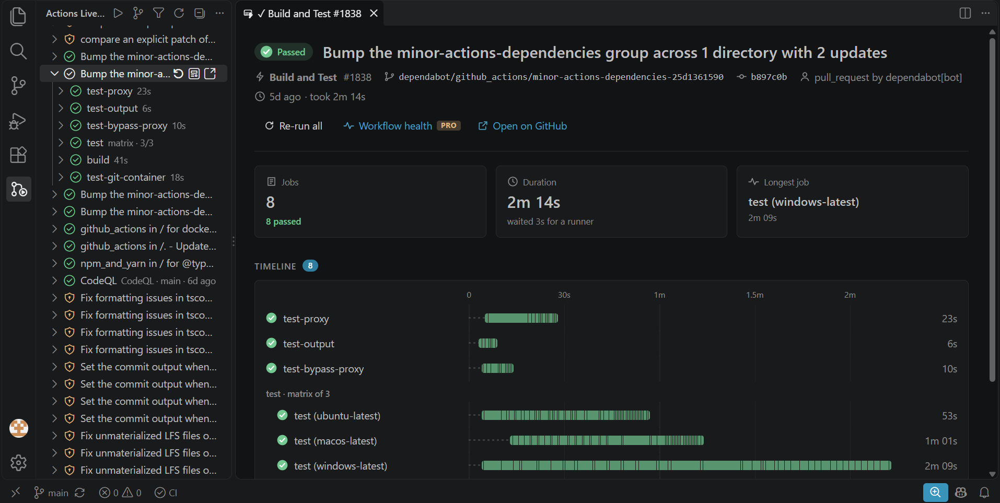
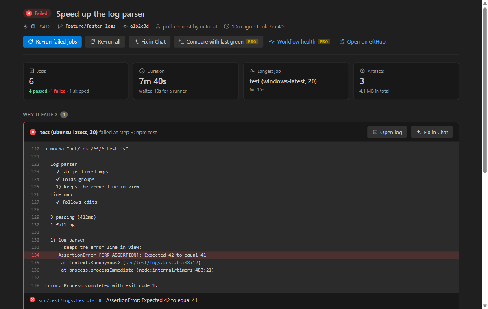
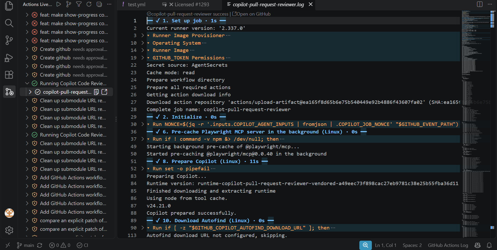
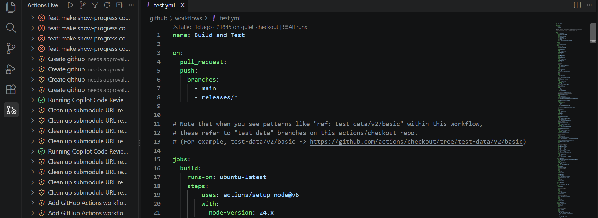
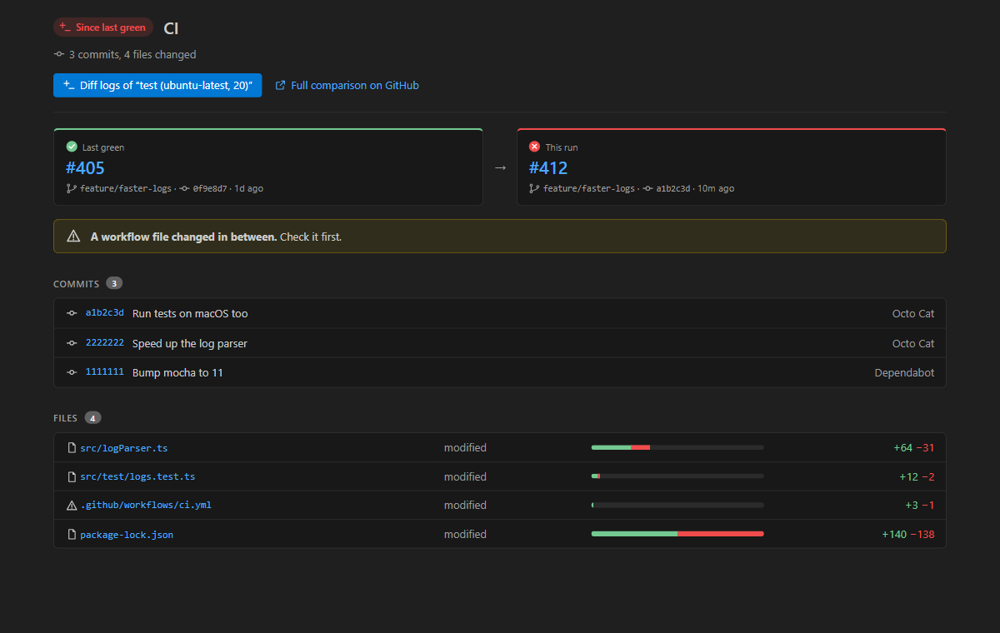
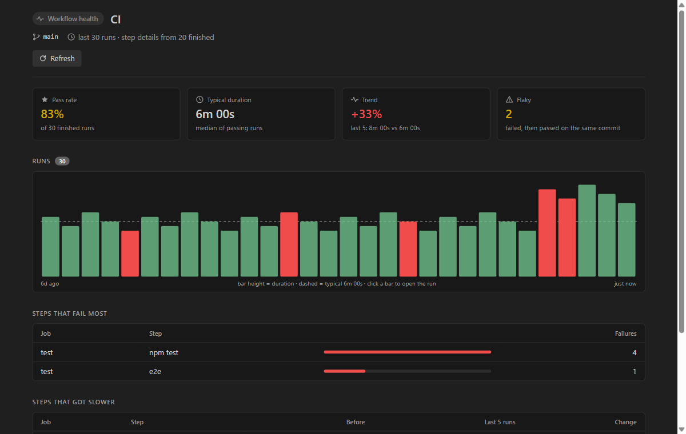

# GitHub Actions Live — CI runs, logs and checks inside VS Code

**See your GitHub Actions run while it runs. When it fails, land on the line that broke.**

Push a commit and its run appears in the side bar, jobs and steps ticking along. The status bar
shows how the checks are doing. When something fails, one click opens the run page with the
error already in view, the file it points to one click away, and the log opening on the failing
step instead of at the top of 5,000 lines of setup. No tab switching, no refreshing github.com.

Works with github.com and **GitHub Enterprise Server**, through the GitHub sign-in VS Code
already has. No token to create, nothing to configure.

## Why people install it

- **It updates live.** Runs, jobs and steps refresh every few seconds while they are active.
  GitHub's own extension makes you click Refresh.
- **Failures are one click away.** Run page → the failing lines → the file. Or straight to your
  AI chat with the failure attached.
- **Every check, not only Actions.** The status bar and the pull request row count Vercel,
  CodeQL, Codecov and any other app's checks along with your workflow jobs, and tell you
  whether the pull request can merge.
- **Enterprise works.** GitHub Enterprise Server and `*.ghe.com` are supported with the same
  sign-in as github.com.
- **Nothing leaves your machine.** No telemetry, no accounts, no server in between.

It sits next to GitHub's own *GitHub Actions* extension rather than replacing it: keep that one
for workflow YAML editing and let this one watch your runs.

## What you get for free

### Live runs, jobs and steps

The Actions Live view lists the workflow runs of the repository you have open. Queued and
running ones update every few seconds; the run of your current commit opens by itself so you
can watch its steps. Matrix jobs are grouped, with how many passed and failed. Runs of pull
requests from forks that wait for a maintainer's approval are shown as such, not as failures.

### A page for every run

Click a run, or the CI item in the status bar, and the run opens in a tab drawn in your theme's
colours:

- **Why it failed** — the lines around the error of each failed job, the error line marked,
  file references you can click, and the job's annotations.
- **Timeline** — every job and step on one time axis, including the time spent waiting for a
  runner, so the slow step stands out. Click a step to open its log there.
- **Actions** — re-run failed jobs, re-run all, cancel, review deployments, download artifacts
  and Fix in Chat, all on the page. It follows the run live while it runs.

### Every check of your commit in the status bar

`⟳ CI 2/5` while checks run, `✓ CI` when they all pass, `✖ CI 1 failed` when one does not.
It counts Actions jobs, other apps' checks and commit statuses — the same list as the checks
box of a pull request. The pull request of your branch sits at the top of the view with its
checks and whether it can merge.

### Logs you can read

A job's log opens as an editor tab:

- timestamps and colour codes removed, `##[group]` blocks folded, a header line per step with
  its result and duration;
- a failed job opens on its first error, with the lines that led to it in view;
- file references like `src/auth.ts:42:7` are links to that line of your workspace;
- errors and warnings are marked in the scroll bar.

GitHub serves a job's log only once the job has finished (its live log is not available to
extensions). Click a running job and choose **Open When It Finishes**: the log opens by itself
the moment it is done, while the steps update live in the view.

### Fix in Chat

On a failed job, **Fix in Chat** opens your editor's chat (GitHub Copilot or any other) with the
failing part of the log, the annotations and the lines of your files they point to already in
the prompt. In agent mode, type `#ciFailures` and the agent reads what failed in CI for your
commit by itself. No chat installed? The same context goes to the clipboard.

### Your workflow files know their runs

Open any file in `.github/workflows` and its first line shows the last run
(`✓ Passed 2h ago · #42 on main`), the pass rate of recent runs, **Run workflow** for
`workflow_dispatch` workflows and **All runs**, which filters the view to that workflow.

### Act on runs

Re-run failed jobs, re-run everything or cancel from a run's row. Approve or reject
**deployments waiting for review**. **Download artifacts** of a run. **Run Workflow…** lists
workflows with a `workflow_dispatch` trigger, asks for their inputs (choices and booleans as
pick lists) and starts one on your branch.

### Filters, and a light touch on the rate limit

Show only your runs, only failed runs, one workflow or only the current branch, and load older
runs on demand. Checks are fast only while something runs, six times rarer otherwise and rarer
still while VS Code is in the background. Unchanged answers use ETags, which GitHub does not
count against the limit.

## Pro

Pro adds the parts that save the most time on a failing build.

**CI errors in the Problems panel, on the right lines.** When CI fails on your commit, its
errors land on the lines of your files they point to — from check-run annotations and from the
failing part of the log (TypeScript, ESLint, Jest, Vitest, pytest, Rust, Go, MSBuild and anything
that prints `file:line`). Edited the file since you pushed? Lines are carried over through
`git diff`, so the error still sits where it belongs.

**Notifications that reach you.** Push, switch to something else, and hear back when CI of
your branch passes or fails, or a deployment waits for your review — as a system notification
when VS Code is in the background, with buttons to open the run or re-run failed jobs.

**What changed since it was last green.** On a failed run: the commits and files between the
last green run of that workflow and this one, a warning when a workflow file is among them, and
a diff of the two logs of the same job with times, ids and durations taken out, so only what
really went differently stands out. Same commit on both? You are told it is likely flaky, with
a re-run button right there.

**Workflow health.** Pass rate, typical duration and trend of a workflow, a chart of its recent
runs, runs that failed and then passed on the same commit (flaky), the steps that fail most and
the steps that got slower.

### Price

Pro is **$4 a month** or **$39 once**, with a **7-day free trial** — no card, no sign-up. Run
**Actions Live: Get Actions Live Pro** from the Command Palette. Everything in the free list
above stays free.

Not happy with Pro? Write within 14 days of buying and the payment is refunded, no questions.
Questions and bug reports: [open an issue](https://github.com/adck8888/github-actions-live/issues)
or write to adck888@gmail.com.

## Settings

| Setting | Default | |
| --- | --- | --- |
| `actionsLive.statusBar` | `true` | CI status of your commit in the status bar |
| `actionsLive.pollSeconds` | `5` | How often to check while a run is active |
| `actionsLive.showTimestamps` | `false` | Keep each line's time in opened logs |
| `actionsLive.codeLens` | `true` | Last run, pass rate and Run workflow above workflow files |
| `actionsLive.notifications` | `mine` | Pro: `mine`, `failures` or `off` |
| `actionsLive.systemNotifications` | `true` | Pro: use system notifications while VS Code is in the background |
| `actionsLive.problemsOnFailure` | `true` | Pro: put CI errors in Problems when your commit fails |

## GitHub Enterprise

Set `github-enterprise.uri` to your server (for example `https://github.example.com`) and sign
in with **GitHub Enterprise** when asked. Remotes on `*.ghe.com` work too.

## Signing in

The extension uses the GitHub account you are signed in with in VS Code (the Accounts menu), with
the `repo` scope that other GitHub extensions ask for too, so one sign-in usually serves them all.
If the view asks you to sign in, click **Sign in to GitHub**; nothing to paste, no personal token.

## Privacy

The extension talks to the GitHub API of your repository's host with your VS Code GitHub
sign-in, and to Lemon Squeezy to check a Pro licence key. **Fix in Chat** and `#ciFailures` put
the log excerpt and nearby source lines into the chat you use, only when you ask. Nothing else
leaves your machine; there is no telemetry.
